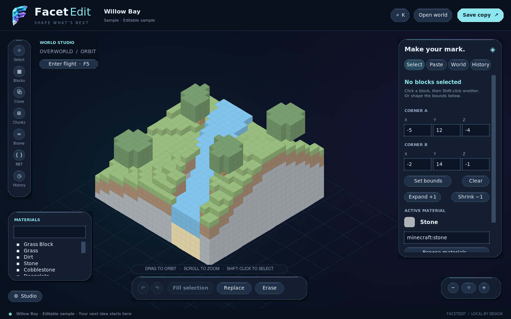

# FacetEdit

A desktop world editor for Minecraft Java and Bedrock, with a dark glass UI and room to focus on your build. Open a world, grab a selection, and start making changes.



## What it does

- Fill, replace, clone, rotate and mirror selections.
- Edit chunks, biomes, inventories and block NBT.
- Import and export structures, including `.construction`, `.nbt`, `.mcstructure` and `.schem`.
- Preview builds with local resource packs, or fly around in 3D.
- Undo changes, save projects and recover unfinished work.

Built from scratch with Python and Tk. The app runs offline and needs no pip packages.


## Run it

Install **Python 3.11+ with Tk**, then clone this repo or download it using **Code → Download ZIP**. From the project folder:

```sh
python3 launch.py
```

On Windows, use `py -3 launch.py`. On Linux, you may need your distribution's `python3-tk` package.

**Current version: 0.8.0.** Still in development, with Amulet feature parity in progress. Cross-edition conversion currently targets Java 1.21.4 and Bedrock 1.21.50; see the compatibility notes for the supported formats and limits.

[User guide](docs/USAGE.md) · [Compatibility](docs/COMPATIBILITY.md) · [Test results](docs/TEST_REPORT.md) · [MIT license](LICENSE)
