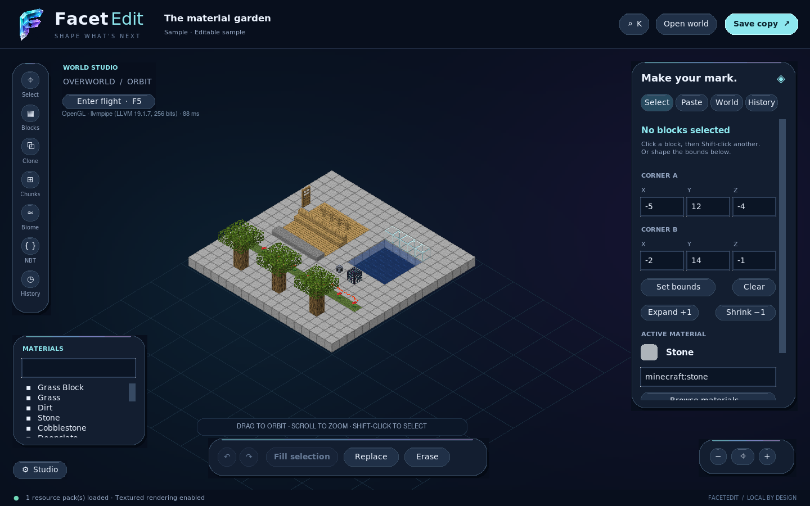

# FacetEdit

**Shape what's next.** An original, offline Minecraft desktop editor with a
crystalline F identity, a dark glass-inspired workspace, and floating tools.
Written from scratch in Python's standard library and Tk. No Amulet code,
translation tables, plugins, third-party Python packages, webview, account,
telemetry, or network service is used by the application.

**Version 0.5.0 is experimental. Full Amulet feature parity is unfinished.**
The editor performs real Java and Bedrock edits; the exact boundaries are in
[Compatibility](docs/COMPATIBILITY.md). Synthetic tests and independent database
validation do not establish that exported worlds have been validated in Minecraft.


## Run on Windows, macOS, or Linux

Use **Python 3.11+ with Tk support**. Python.org's Windows/macOS installers include
Tk; Linux distributions usually provide it as `python3-tk`. These are the base
runtime prerequisites. There is no `pip install` step.

```sh
python3 launch.py
```

Windows:

```powershell
py -3 launch.py
```

Or extract `FacetEdit-0.5.0-portable.zip` and open the matching platform launcher.
The portable app is a Python zipapp, not a self-contained `.exe` or signed `.app`:

```sh
python3 FacetEdit.pyz
python3 FacetEdit.pyz --diagnose
```

Pass a world folder or `.facet` project as the first argument. Legacy `.luma` and
`.facetedit` projects remain readable. Existing Luma preferences are read once
when new FacetEdit preferences do not yet exist; originals are not overwritten.
Linux desktop testing used Python 3.13.5 / Tk 8.6 with antialiased system fonts.
Native Windows/macOS execution has not been verified in this environment.

## The workspace

- **World stage:** full-width voxel cutaway with orbit, zoom, pan, block picking,
  construction grid and cyan selection bounds. Drag to orbit, right-drag to pan,
  and scroll to zoom. F5 switches to perspective flight: WASD moves, Q/E moves
  down/up, Shift boosts speed, drag looks around, and scroll adjusts speed.
  Go to coordinates changes the orbit center/Y ceiling or the flight position.
- **Tool rail:** select, materials, clone, chunks, biomes, block NBT and history.
- **Floating inspector:** segmented Select / Paste / World / History pages.
  Enter numeric corners, adjust bounds, transform a clipboard, change dimension,
  edit metadata, or rewind to an earlier available step.
- **Material tray:** searchable at larger sizes; the rail opens the same library
  in a dialog on compact windows. Custom names and states can be entered.
- **Action dock:** undo, redo, fill, replace and erase. File operations run through
  a worker queue; Tk stays on the main thread.

Midnight Glass is the default. The layered colors, curved controls, gradients
and edge highlights are drawn locally. They are an iOS 26-inspired appearance;
Tk does not provide Apple's native backdrop-refraction material.

**View → Resource packs and graphics** opens the material studio. Add local Java
resource-pack folders/ZIPs or a Minecraft client JAR, order the stack and apply.
Textures, JSON block models, cutouts, translucent surfaces, level-based fluids,
biome colormaps and optional texture animation appear in orbit and flight.
System OpenGL runs on a worker thread; a portable Python renderer is available
when native graphics cannot be used. No game assets are bundled or downloaded
by the app. See [Resource rendering](docs/RESOURCES.md) for setup and boundaries.



## Edit and save

1. The initial **Willow Bay** scene is an editable procedural sample in memory.
   **Open world** selects a folder containing `level.dat`. The World tab can also
   extract a Bedrock `.mcworld` archive into a new folder.
2. Click a block and Shift-click another, or enter two inclusive corners. Choose
   a material, for example `minecraft:oak_log[axis=y]`, and fill/replace/erase.
   **Manage selection regions** combines boxes or subtracts holes. Overlaps are
   edited once; clipboard gaps stay empty of edits. Use `.nbt` or `.mcstructure`
   for sparse structures; `.schem` export requires a complete rectangular volume.
3. Copy, cut, paste or repeat a selection with Clone. Block entities such as
   container inventories retain their typed NBT and relocated coordinates.
   Biome and NBT edits participate in undo, redo, projects and edited-world export.
4. **Save original world** (Ctrl/Cmd+S) installs a prepared copy and retains the
   original in a backup folder beside the world. Close Minecraft first. File →
   **World save checkpoints** restores a backup or finishes an interrupted save.
   **Save copy** exports to a new folder; Bedrock also exports `.mcworld` archives.
5. **Save FacetEdit project** stores pending changes and a reference to the
   original source folder. Keep that source at its recorded path and unchanged.
   Sample projects preserve the sample generator and changes without an external
   world folder.
6. **Manage chunks** opens a map for creation of empty chunks, deletion, pruning
   outside the selection, and import from another matching-edition/version world.
   Imports keep their coordinates. Java terrain, POI, entity and external-chunk
   payloads travel together; Bedrock actor references are preserved. Chunk edits
   support undo and projects. Empty chunks do not generate terrain; Bedrock needs
   known game-version metadata and an existing same-dimension biome template.
7. Unsaved work gets a **recovery checkpoint every 30 seconds** outside the source
   world. File → Recovery workspaces restores or discards these copies. Studio
   preferences control autosave and its interval. Saving or closing cleanly
   clears the current checkpoint; interrupted sessions remain discoverable.

Java `.nbt`, Bedrock `.mcstructure`, Sponge `.schem` v2/v3, and legacy Java
`.schematic` interchange blocks and block NBT. Bedrock structures preserve both
storage layers; the editor and projects retain up to eight world storage layers.
Moving entities, scheduled-tick structure metadata and schematic biomes are
refused when detected. Java DataVersion and edition must match the destination;
universal version/edition translation is unfinished.

**Free transform & preview** in Paste provides arbitrary X/Y/Z angles, per-axis
scaling/reflection, numeric destinations and nudge controls. A placement outline
and representative blocks appear without editing the world. Arbitrary angles
resample voxels; cardinal transforms retain exact coordinates. Common Java and
Bedrock directional states, rails, stairs, hinges and container links rotate.
Some tilted/legacy states cannot be represented; disable state rotation to
transform geometry alone. Opaque nested NBT coordinates are not universally moved.

**Set biome** supports box or full-column selection, Java numeric/paletted layouts
and Bedrock 2D/3D biome storage. Unknown numeric IDs can be entered as `numeric:ID`.
Custom Java dimension heights resolve from metadata and enabled datapacks.
**Waterlog** updates Java properties or Bedrock secondary water layers; **Layered
fill** offers overlay, underlay, game-like placement and explicit first/second
layer modes. Typed block NBT retains numeric widths, lists and arrays through undo.

**Custom operations** runs bundled checkerboard/shell operations or trusted
Python scripts with typed options, progress, cooperative cancellation and a
single undoable commit. See the [operation API](docs/OPERATIONS.md). Amulet plugins
that import its libraries are not compatible with this independent API.

Pre-1.13 Anvil worlds retain numeric IDs/metadata, including modded 12-bit IDs.
Use historical names such as `wool[legacy_data=14]` or `legacy:300[legacy_data=12]`.
This is lossless numeric editing, not automatic conversion to modern block states.

## Shortcuts

Use Ctrl on Windows/Linux and Command on macOS.

| Shortcut | Action |
| --- | --- |
| O | Open world |
| S | Save original world with retained backup; sample: save project |
| Shift+S | Save project |
| Z / Y or Shift+Z | Undo / redo |
| C / X / V | Copy / cut / paste |
| K | Command search |
| Delete / Escape | Erase / clear selection |

F5 switches orbit/flight without a modifier. Flight controls only act while the
viewport has keyboard focus; clicking a field or opening a dialog stops movement.

Text fields retain normal text editing. Buttons accept Tab focus, Return and
Space. Inspector pages scroll in compact windows. Recent worlds are under File.

## Development and evidence

```sh
PYTHONPATH=src python3 -m unittest discover -v
PYTHONPATH=src FACETEDIT_GUI_TESTS=1 python3 -m unittest discover -v
python3 scripts/benchmark.py
python3 scripts/build.py
```

GUI tests require a desktop or X display. Headless Linux can use `xvfb-run -a`.
PowerShell: set `$env:PYTHONPATH="src"` and `$env:FACETEDIT_GUI_TESTS="1"` first.
The optional visual-review script uses ImageMagick only to capture screenshots;
optional independent binary validation uses native LevelDB/Snappy/LZ4/xxHash as test
oracles. Those tools are not bundled or imported by the application.

The build creates a compressed zipapp, platform launchers, portable/source ZIPs,
and SHA-256 checksums. CI definitions cover three OS families; remote runs and
native platform release signing remain unverified.

Read the [implementation plan](docs/IMPLEMENTATION_PLAN.md),
[redesign plan](docs/REDESIGN_PLAN.md), [compatibility ledger](docs/COMPATIBILITY.md),
[full parity worklist](docs/FULL_PARITY_WORKLIST.md) and [test report](docs/TEST_REPORT.md).
The application source is MIT-licensed.
FacetEdit is independent of Amulet, Mojang and Microsoft; their names identify
reference software and file formats, not ownership or endorsement.
